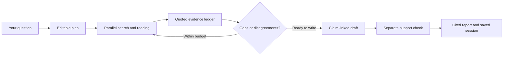

<div align="center">
  

  <p>A native macOS workspace for research you can inspect, question, and revisit.</p>

  <p>
    <a href="https://github.com/umararshad4/deephoney/releases/tag/v0.1.0-alpha.1"></a>
    
    
    <a href="LICENSE"></a>
    <a href="https://github.com/umararshad4/deephoney/actions/workflows/ci.yml"></a>
  </p>

  <p>
    <a href="#quickstart">Quickstart</a> ·
    <a href="#four-research-modes">Modes</a> ·
    <a href="docs/research.md">How it works</a> ·
    <a href="docs/configuration.md">Configuration</a> ·
    <a href="https://github.com/umararshad4/deephoney/releases">Releases</a>
  </p>
</div>

---

DeepHoney turns a question into an editable investigation, gathers quoted evidence across public sources, checks disagreements, and writes a cited report. It is built with Rust and GPUI, with a UI-free engine you can also run from the terminal.

> **Development preview · v0.1.0-alpha.1**
>
> The research loop, report writer, and optional built-in Tor are implemented. This release contains source code, with no signed installer. Live cloud-model and paid-provider validation remains incomplete.

## What you can do

- **Shape the investigation.** Review and edit perspective lenses, questions, source adapters, and queries before the searches begin.
- **Follow the evidence.** Watch searches, pages, identifier pivots, claims, and warnings in the live feed. Inspect each report's underlying ledger.
- **Check disagreement.** Group copied articles into one voice, record contradictions, and use Adversarial mode to seek counterevidence.
- **Look beyond ordinary search.** Query scholarly records, filings, court records, code, archives, public channel previews, and filtered onion results.
- **Keep your work.** Reopen saved reports, claims, sources, and historical passages. API keys stay in the macOS Keychain.

## Quickstart

You need **macOS 15+**, the **current stable Rust toolchain**, **Apple Command Line Tools**, and a configured model provider. Development checks used Rust 1.99.1; older toolchains have not been validated. GPUI compiles its Metal shaders at runtime, so the Xcode `metal` tool is not required.

If the Apple tools are missing, run `xcode-select --install` and complete the installer before building. Install Rust with [rustup](https://rustup.rs/).

```sh
git clone https://github.com/umararshad4/deephoney.git
cd deephoney
cargo run -p app --locked
```

1. Open **Settings**. Add an Anthropic API key or configure an OpenAI-compatible endpoint, including a local model server.
2. Add a search provider key or your SearXNG URL. Without either, DuckDuckGo HTML is a best-effort fallback.
3. Enter a topic, choose a mode, and click **Plan**.
4. Edit the questions or queries, then click **Run**.
5. Read **Report**, **Claims**, **Sources**, and **Deleted**. Completed investigations save to the sidebar.

Depth limits the rounds. Breadth limits queries per lens. Settings also lets you set a page budget and opt into built-in Tor. You can cancel an investigation while it runs.

For the exact preview version, check out `v0.1.0-alpha.1` before running Cargo. See [configuration](docs/configuration.md) for models, credentials, environment variables, and data locations.

## Four research modes

| Mode | What it adds |
|---|---|
| **Normal** | Public web, scholarly, filing, court, code, and community sources, with quoted claims and gap checks. |
| **Hidden data** | Wayback discovery, archive recovery, and historical text comparisons. |
| **Dark web** | Filtered Ahmia discovery and onion-page reads through built-in Arti. Requires Tor opt-in. |
| **Adversarial** | Reserved counterevidence searches and a further review of contested evidence. |

Dark web and Adversarial are separate modes. Availability depends on the source, your credentials, and rate limits. See the [source catalog and transport reference](docs/sources.md).

## From question to report



The engine bounds concurrency, queries, rounds, and page attempts. It follows useful links and identifiers, prunes unproductive branches, and stops after two rounds without new claims or independent voices.

Report statements must map to recorded claims and pass a separate model check against their quotes. Citation numbers come from those mappings. Required sections include findings, contested evidence, coverage gaps, and sources. Historical passages retain their archive provenance.

**Evidence scores are heuristics, not truth guarantees.** Textual similarity estimates source independence. URL patterns estimate source quality. Models still judge support and contradictions. Read the [research and report reference](docs/research.md) for the exact rules and limits.

## Run research from the terminal

The engine works without GPUI. It reads environment variables rather than desktop Keychain settings.

```sh
# Configure ANTHROPIC_API_KEY in your environment first.
cargo run -p engine --example cli --locked -- \
  "How has battery recycling changed?" \
  --mode hidden --depth 3 --breadth 3 --pages 80 > report.md
```

Markdown goes to stdout. JSON progress events go to stderr. For OpenAI-compatible providers and the full flag list, see [headless configuration](docs/configuration.md#headless-research).

## Privacy and boundaries

- Only onion-page reads use Tor. Search requests, Ahmia discovery, and configured model APIs use direct connections.
- A remote model receives research evidence, including evidence read through Tor. This is not a tool for whole-session anonymity.
- Keys use the macOS Keychain. Settings and session evidence are stored locally; the session database is plaintext.
- Page readers accept bounded HTML or plain text. They do not execute JavaScript, log into sites, submit forms, or download PDFs and media.
- Common Crawl discovers URLs to current pages. It does not replay archived WARC content. Wayback provides archive captures.

## Documentation

| Guide | Contents |
|---|---|
| [Configuration](docs/configuration.md) | Providers, keys, storage, budgets, Tor, and CLI variables |
| [Research and reports](docs/research.md) | Planning, pivots, stopping rules, statement verification, citations, and scoring |
| [Sources and transport](docs/sources.md) | Twenty registered adapters, credentials, archive semantics, and onion routing |
| [Development](docs/development.md) | Engine interface, code map, checks, and validation boundaries |
| [Contributing](CONTRIBUTING.md) | Local workflow and useful bug reports |
| [Changelog](CHANGELOG.md) | Versioned changes and release policy |

## Development status

Local workspace validation passed **60 tests**, strict Clippy, and a desktop build. Native plan/edit/run, saved sessions, report views, and Keychain persistence were exercised with local model fixtures. A real onion page was fetched through embedded Arti.

Remaining checks include a live cloud-model investigation, paid or token-gated providers, broader UI testing, and macOS signing and notarization. Some public endpoints returned bot challenges, rate limits, or timeouts. See [validation details](docs/development.md#validation) for the distinction between local fixtures and live probes.

## License

[MIT](LICENSE) · Copyright 2026 Umar Arshad.
